# Code Flow

## End-to-end data-to-map diagram

```mermaid
flowchart LR
    subgraph Inputs["1. Input data and configuration"]
        IRS["IRS EO BMF state CSV files"]
        Codes["Selected NTEE codes"]
        External["Future external CSV / JSON / GeoJSON"]
        Crosswalk["category-crosswalk.json<br/>versioned source-to-GCC mappings"]
        Schema["map-schema.json<br/>controlled filter values"]
        Env[".env API keys and model settings"]
    end

    subgraph Normalize["2. Normalize records"]
        Build["build_irs_dataset.py<br/>filter, clean, stable IDs,<br/>provisional schema categories"]
        Adapter["normalize_external_data_without_llm.py<br/>aliases, canonical values,<br/>deterministic fallback rules"]
        Merge["Combined normalized organizations<br/>(future merge step: TBD)"]
    end

    subgraph Locate["3. Assign map coordinates"]
        Geocode["geocode_organizations.py"]
        GeoCache[(Census geocode cache)]
        Census["U.S. Census batch geocoder"]
        Fallback["ZIP / city centroid fallback"]
    end

    subgraph Enrich["4. Optional AI enrichment: --enrich-with-jev"]
        BraveSearch["Brave Search<br/>primary website discovery"]
        Discovery["OpenRouter web search<br/>fallback for low-confidence cases"]
        DiscoveryCache[(Supabase pipeline_cache<br/>Brave, discovery, web search)]
        Crawl["Deterministic crawler<br/>email, phone, contact page"]
        ContactFallback["OpenRouter web search<br/>contact fallback when site blocked"]
        Jev["System One Jev via OpenRouter<br/>all 8 schema choices in one request"]
        JevCache[(Supabase pipeline_cache<br/>Jev answers)]
    end

    subgraph Publish["5. Validate and save"]
        GeoJSON[(Supabase organizations table)]
        Validate["main.py validation<br/>FeatureCollection, Points,<br/>coordinate ranges"]
        Server["Local static HTTP server"]
    end

    subgraph Browser["6. Browser map"]
        App["app.js loads approved organizations + schema"]
        Filters["Search, counts, and schema filters"]
        MapLibre["MapLibre clusters, points, and tooltips"]
        OSM["OpenStreetMap raster tiles"]
        User["Climate Org Mapping UI"]
    end

    IRS --> Build
    Codes --> Build
    External --> Adapter
    Crosswalk --> Build
    Crosswalk --> Adapter
    Build --> Merge
    Adapter -.->|"enabled when additional sources are integrated"| Merge
    Merge --> Geocode

    GeoCache --> Geocode
    Geocode -.->|"--use-census"| Census
    Census --> GeoCache
    Geocode -->|"usable address match"| GeoJSON
    Geocode -->|"missing or failed match"| Fallback
    Fallback --> GeoJSON

    GeoJSON -.->|"records not already enriched"| BraveSearch
    Env -.-> BraveSearch
    BraveSearch -->|"confident match"| DiscoveryCache
    BraveSearch -.->|"no confident match"| Discovery
    Env -.-> Discovery
    DiscoveryCache --> Discovery
    Discovery --> DiscoveryCache
    DiscoveryCache -->|"official site found"| Crawl
    Crawl -->|"accessible: contacts extracted"| GeoJSON
    Crawl -.->|"blocked or unreachable"| ContactFallback
    ContactFallback -->|"email, phone, contact page"| GeoJSON
    DiscoveryCache -->|"official site found"| Jev
    Env -.-> Jev
    JevCache --> Jev
    Jev --> JevCache
    Jev -->|"website, summary, canonical categories"| GeoJSON

    GeoJSON --> Validate
    Validate --> Server
    Server -->|"static app files"| App
    GeoJSON -->|"approved rows, map fields only"| App
    Schema --> App
    App --> Filters
    App --> MapLibre
    Filters -->|"filtered FeatureCollection"| MapLibre
    OSM --> MapLibre
    MapLibre --> User
```

Solid arrows show the normal data path. Dashed arrows show optional, incremental,
or externally configured work. Existing output and cache entries are reused, so
ordinary reruns skip completed builds, coordinate assignment, website discovery,
and Jev classification unless their inputs or version keys change.

## Main entry-point flow

1. `main.py` loads missing settings from `.env` (the Supabase URL and service role key are required), parses command options, and loads every approved organization from Supabase.
2. Reuse those records, or run the IRS build flow when the table is empty or `--rebuild` is explicit.
3. Reuse complete existing coordinates, run safe fallback assignment when needed, or enable Census submissions with `--use-census`.
4. When `--enrich-with-jev` is explicit, discover official websites, collect evidence and summaries, and classify all schema fields with Jev through OpenRouter.
5. Validate point geometry, coordinate ranges, and fallback count, then save new and changed records to Supabase through `sync_pipeline_organizations` (if enrichment stops early, finished records are saved first).
6. Start the static map server unless `--no-serve` is supplied.

## Website and Jev enrichment flow

1. Identify an organization using its name, IRS address, location, EIN, and NTEE context.
2. If a `BRAVE_API_KEY` is configured, query Brave Search with the organization name, city, state, and `nonprofit`. Score each result by name-word overlap, city/state match, and `.org` domain signal. Accept the top result when its score is ≥ 0.5; return it as a discovery dict.
3. If Brave returns no confident match (or is not configured), call OpenRouter chat completions with the `web` plugin to find the official website and return a structured summary, evidence text, supporting URLs, match confidence, and match status.
4. Cache the discovery result by immutable organization identity, prompt version, and search model, and mark the record with those versions.
5. When an official site is found, run the deterministic crawler: check `robots.txt`, fetch the homepage, extract `email` and `phone` from `mailto:` and `tel:` links (falling back to regex), and find a same-domain contact page link. If a contact page is found and robots-allowed, crawl it and fill any blank contact fields from it. If the crawler was blocked by `robots.txt` or the site was unreachable (`accessible=False`), call OpenRouter web search as a contact-extraction fallback — it may surface contact details from its cached index.
6. Pass the organization identity and extracted website evidence to OpenRouter's Decisions API.
7. Ask `typesafe/jev-1.13` all eight schema questions as independent `choice` decisions over one shared state and one API request.
8. Validate every Jev choice against the controlled schema, persist the probability distributions and request metadata, and update the public filter fields.
9. On later runs, exclude records already complete for the active discovery and Jev versions before applying the requested processing limit.
10. Keep website discovery separate from verification; an official website does not make a record Verified.

## Build flow

1. Parse command-line arguments.
2. Load selected NTEE codes.
3. Discover state CSV files.
4. Stream each CSV row.
5. Reject rows whose exact NTEE code is not selected.
6. Resolve climate, action, activity, and resilience through the shared versioned crosswalk.
7. Apply narrow organization-name evidence only where the documented rules allow it.
8. Normalize accepted fields and attach mapping basis/version provenance.
9. Derive a stable ID and emit null geometry with `location_precision=ungeocoded`.
10. Return the FeatureCollection to `main.py`, which saves it to Supabase after geocoding.
11. Print processed, emitted, and skipped counts.

## Geocoding flow

1. Take the records from `main.py` (or load them from Supabase when run on its own) and the existing Census cache.
2. Apply reusable cached Census matches.
3. Unless `--fallback-only` is active, select uncached complete addresses and submit batches of up to 5,000 to the official U.S. Census Geocoder.
4. Persist each submitted batch immediately, including non-matches.
5. Assign Census address-range geometry to matched records.
6. Place remaining records near their ZIP centroid, else their city centroid (scatter ≤ 0.005°); records matching neither get null geometry and `location_precision=unavailable`.
7. Write precision, provider, status, match type, normalized address, and timestamp metadata.

## Browser flow

1. Load `map-schema.json`, then every `approved` organization from Supabase: only the map fields (name, address, city, state, ZIP, EIN, coordinates and the filter fields), 1,000 rows per request, the first request returning the total and the rest fetched in parallel.
2. Opening a popup fetches that organization's full record (website, contacts, summary) and caches it for the visit.
3. Populate filter values from feature properties.
3. Initialize MapLibre and its cluster layers.
4. Apply text and select filters when controls change.
5. Update the map source, counts, and bounded result list.
6. Fly to and display a popup when a result or point is selected.

## Add and admin flows

- `add.html`: validate → geocode the street address with the Census one-line geocoder (JSONP, since it sends no CORS headers), falling back to the ZIP center from `data/zip-centroids.json`; a picked Photon address suggestion with a house number is used directly → build properties → insert as `pending` / `public_form` / `Not Verified`. CSV uploads (≤200 rows) run the same steps per row.
- `admin.html`: email-link sign-in (Supabase Auth) → `is_admin()` check → approve or delete pending rows, search and edit any row (saved as `admin`, `approved`), add new ones, delete, CSV upload (live immediately, may set Verified).
- Pipeline: `main.py` saves straight to Supabase. Rows the admin or a visitor changed keep their values; the pipeline only fills their empty fields and its own bookkeeping fields.

## Survey flow

`survey.html` loads `data/survey.json` and shows one section at a time. Next checks the section's required questions, then follows a branch chosen by an answer (`options[].goto`) or the section's `after` (`next`, `submit` or a section id). Submit sends the answers from the sections on the path taken to `survey_responses`. Opened from a map listing, it pre-fills that organization. On `admin.html`, "Review & verify" maps the answers to listing fields and filters, opens the editor, and Save updates `organizations` and marks the response `approved`.

## External-source normalization flow

1. Read CSV, JSON, or GeoJSON records.
2. Resolve common aliases or an explicit field map into GCC fields.
3. Canonicalize recognized target values supplied explicitly by the source.
4. Resolve an NTEE code, code-bearing category, or exact equivalent NTEE label through the shared crosswalk.
5. Apply ordered organization-name rules only where explicit and crosswalk values are unavailable.
6. Preserve the original label plus resolved code, mapping basis, and crosswalk version.
7. Assign deterministic stable IDs and schema-version metadata.
8. Write normalized CSV or JSON for later matching and merging.
