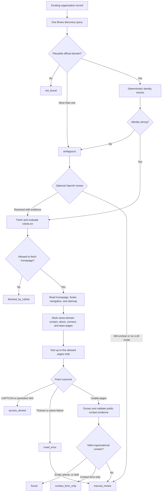

# Website contact discovery and extraction plan

## Project goal

The Climate Org Mapping project has 20,577 existing organization records derived from the IRS Exempt Organizations Business Master File. This plan describes how to find each organization's official website and extract a public organizational email address, a public organizational phone number, and, when available, a contact-page URL. Missing values remain blank. The process must never infer or invent contact details.

The recommended design uses Brave Search to discover likely official domains, deterministic rules to verify identity, and a small generic crawler to inspect a few allowed pages on the selected domain. OpenAI is reserved for ambiguous cases. Manual review or blank fields are valid final results when the evidence is weak, a site blocks access, or no public contact exists.

## Scope and boundaries

### Data to obtain

The process may add these values to an organization record:

- `website_url`, the accepted official website.
- `email`, a public general-purpose organizational email address.
- `phone`, a public general-purpose organizational phone number.
- `contact_page_url`, an optional page or form where the public can contact the organization.

The process also records provenance, crawl policy decisions, confidence, review state, and status. A record with one valid field and two blank fields is complete for this process if no stronger public evidence exists.

### Data to avoid

- Do not guess an email pattern from a person's name or a domain.
- Do not infer a phone number from a neighboring organization, parent organization, directory, or search snippet.
- Do not auto-publish a named individual's direct email address or direct phone number.
- Do not bypass a login, paywall, CAPTCHA, access-denied response, or technical protection.
- Do not submit contact forms.
- Do not crawl social networks, directory sites, search result pages, or unrelated domains as though they were the organization's own site.

Prefer general contacts such as `info@`, `contact@`, `office@`, or a published main office number. A role address such as `programs@` may be retained when no general address exists and the role is clearly organizational. Named staff details require a separate policy and human review. Until that policy exists, keep them out of the public dataset.

## Recommended strategy

Use Brave Search and deterministic crawling as the main path. Send only ambiguous identity or page-selection cases to OpenAI. This design limits paid search calls, nearly eliminates model-token cost, and keeps each accepted value tied to a public source page.

| Strategy | Strength | Limit | Recommendation |
| --- | --- | --- | --- |
| Brave Search plus deterministic crawler | Low predictable discovery cost, direct source evidence, and no model tokens for clear cases | Requires crawler maintenance and careful identity rules | Main path |
| Brave Search plus OpenAI review for ambiguous cases | Handles name collisions and unclear pages without paying model cost for every record | Adds token cost and requires output validation | Use after deterministic checks fail |
| OpenAI built-in web search for every record | Combines search and model reasoning | Higher cost and search-content tokens may increase the estimate | Do not use as the default |
| Deterministic no-LLM mode | No model-token charge and fully reproducible decisions | Leaves more records unresolved | Supported strict-budget mode |
| Manual-only research | High judgment for difficult records | Too slow for 20,577 records | Terminal fallback for selected records |

The extreme no-LLM mode uses Brave results, deterministic identity checks, and the generic crawler. It marks unresolved records `ambiguous`, `manual_review`, or `not_found` and leaves their fields blank.

## Search indexes and the project crawler are separate

Brave Search and OpenAI web search use provider-managed indexes. Brave states that its API uses Brave's independent web index. OpenAI documents `OAI-SearchBot` as the crawler used to surface sites in OpenAI search results. Neither provider's result means that the Climate Org Mapping crawler may fetch the returned page.

The project crawler is a separate automated client with its own user agent, request history, and robots decisions. Before each fetch, it checks the target site's current `robots.txt` rules for the project's user agent. A URL returned by Brave or OpenAI does not authorize access to a page disallowed for the project crawler. Brave also states that its API does not grant rights to third-party webpages and that storing API results requires a plan with storage rights. Review the selected Brave plan before retaining result bodies or snippets. Store the minimum search metadata needed for an audit, and avoid retaining snippets unless the plan permits it.

Relevant official references include the [Brave Search API pricing, storage, and third-party rights notice](https://brave.com/search/api/), [OpenAI API pricing](https://developers.openai.com/api/docs/pricing), and [OpenAI crawler documentation](https://developers.openai.com/api/docs/bots).

## End-to-end method

### 1. Prepare the input record

Use the organization name, city, state, postal code, street address when available, EIN, and IRS name aliases. Normalize case, punctuation, corporate suffixes, and whitespace for comparison, but preserve the original values.

Build one primary search query per record. A useful shape is the quoted organization name plus city, state, and a term such as `nonprofit` or `official`. Do not include an EIN by default because many sites do not publish it and the number can reduce recall. Use an EIN only as a second-pass identity check or manual query when the first query is ambiguous.

### 2. Discover candidate websites

Send one Brave Search request per record for the first pass. Keep the top few plausible results, usually no more than five candidate domains. Exclude obvious social networks, search engines, people-search sites, business directories, scraped profile sites, document mirrors, and URL shorteners from automatic selection.

Record the provider, query version, request time, request count, candidate URL, and rank. Retain snippets only if the Brave plan grants the required storage rights. A later search retry should occur only when the first query has no plausible candidate or when a record changes materially.

### 3. Select an official domain with deterministic checks

Normalize each candidate to its registrable domain and canonical HTTPS URL. Score identity evidence from the candidate page and the existing organization record. Strong positive signals include:

- An exact or close match to a distinctive organization name in the page title, heading, structured data, or footer.
- A matching city, state, postal code, street address, or service area.
- A matching EIN in a footer, transparency page, or filing document.
- A matching general phone number or address already present in a trusted source.
- Consistent organization branding across the homepage, about page, and contact page.
- An official-site statement that names the legal organization or a clearly documented former name.

Negative signals include:

- A different organization with the same or a similar name.
- Conflicting city, state, mission, or legal identity.
- A chapter or affiliate presented as though it were the national organization, or the reverse.
- A directory, social profile, fundraiser, news article, domain parking page, or dissolved-domain resale page.
- A domain that mentions the organization only as a partner, sponsor, grantee, or event participant.

Automatic acceptance requires at least one strong name signal and one independent corroborating signal, with no material conflict. An exact distinctive name plus a matching city and state is normally enough. A generic name such as "Green Team" needs stronger evidence. When two candidates remain plausible, set `ambiguous` and use OpenAI or manual review. Do not choose the top-ranked search result only because it ranks first.

### 4. Check crawl permission

Identify the crawler with a stable user-agent token and a public page that explains its purpose and gives a contact address. Fetch `/robots.txt` before site pages and evaluate rules for that token. [RFC 9309](https://www.rfc-editor.org/rfc/rfc9309.html) defines the Robots Exclusion Protocol. Python's [`urllib.robotparser`](https://docs.python.org/3/library/urllib.robotparser.html) can evaluate `can_fetch`, `crawl_delay`, `request_rate`, and sitemap declarations.

Use this conservative policy:

- Follow the most specific applicable `Allow` and `Disallow` rules.
- Honor a valid `Crawl-delay` or `Request-rate` when it is stricter than the project's default.
- Cache a successful robots response for no more than 24 hours unless normal HTTP cache headers require a shorter period.
- Treat a robots response that is unreachable because of a network or server error as disallow for that run.
- Treat a normal 404 for `/robots.txt` as no published rule, but still apply the project's request limits.
- Record the robots URL, fetch time, HTTP result, applied user agent, decision, and rule source.
- Never interpret a robots allowance as permission to bypass authentication, a CAPTCHA, copyright restrictions, terms, or an access-denied response.

RFC 9309 states that robots rules are not access authorization. For this project, a disallow rule is still a firm operational stop.

### 5. Crawl a small set of likely pages

Fetch the allowed homepage first. Parse the footer, header, navigation, page links, structured data, and any sitemap URL declared in `robots.txt`. Rank same-domain pages, then visit only the top three to five allowed pages. Count the homepage in the five-page total.

Useful positive page-ranking signals include:

- Link text or URL segments containing `contact`, `contact-us`, `connect`, `about`, `about-us`, `team`, `staff`, `who-we-are`, `locations`, or `visit`.
- A title or heading that contains "Contact", "Get in touch", "About", "Connect", or the organization name.
- A link in the primary navigation or footer.
- A short path with no query string or session identifier.
- A sitemap entry whose last-modified date is recent and whose path matches a contact term.

Useful negative signals include:

- Off-domain links.
- Donation checkout, login, member portal, event registration, store, careers, press article, tag, author, calendar, or search-result paths.
- Files larger than the configured response limit.
- Repeated URLs that differ only by tracking parameters, fragments, trailing slashes, or common locale variants.

The crawler does not need a template for each website. Most sites expose the same semantic clues through HTML links, page titles, headings, footers, `mailto:` and `tel:` links, JSON-LD, and common contact words. A generic crawler ranks those clues instead of depending on a site's visual layout or content-management system. Site-specific adapters should be rare and justified by pilot evidence.

### 6. Extract contact evidence

On each allowed page, examine these sources in order:

1. Schema.org `Organization` and `ContactPoint` JSON-LD.
2. `mailto:` and `tel:` links.
3. Visible labeled contact text in the main content, header, or footer.
4. A same-domain contact form or contact-page URL.

The [Schema.org Organization type](https://schema.org/Organization) defines organization properties such as `email` and `telephone`. The [Schema.org ContactPoint type](https://schema.org/ContactPoint) defines a contact point and its contact type. Structured data is evidence, not proof. Validate it against the page identity and normalize it before acceptance.

Normalize phone numbers without discarding the displayed source form. Preserve extensions. Normalize an email address to a comparison form while keeping the original address for display. Reject malformed addresses, placeholders, example domains, tracking relay addresses, image filenames, and script fragments.

If a page contains only a contact form, store the form page URL and set `contact_form_only`. Do not submit the form, attempt to reveal its recipient, or turn hidden implementation values into a published email address.

### 7. Validate, choose, and store

Compare every contact to the accepted official domain and page identity. Prefer contacts published on the official site. Do not promote a search snippet, directory entry, or Form 990 contact into the main record without a separate source policy and review.

Choose one value per public field with this precedence:

1. A general organization contact confirmed on two official pages.
2. A general organization contact on one clear official contact page.
3. A general organization contact in valid JSON-LD that matches the page identity.
4. A role-based organization contact when no general contact exists.
5. No value.

Keep all observations as provenance records even when only one becomes the current public value. Conflicting values move the record to review unless one is clearly stale, malformed, or superseded on the same official site.

## Crawl limits and stop conditions

Start with these limits and revise them only from pilot evidence:

| Control | Recommended default |
| --- | --- |
| Domain concurrency | One active request per domain |
| Per-domain request rate | At most one request per second, or slower when `robots.txt` specifies it |
| Pages per organization | Five total, including the homepage |
| Link depth | One link from the homepage, with a sitemap-selected contact page treated as depth one |
| Candidate domains | Five from the first search response |
| Domains crawled | One accepted domain, or at most two while resolving ambiguity |
| Connection timeout | 10 seconds |
| Total response timeout | 20 seconds |
| HTML response limit | 2 MB after decompression |
| Redirects | Five, with a new robots check before fetching a different authority |
| Transient retries | One retry for a timeout, `429`, or `5xx`, after the server's `Retry-After` value or exponential backoff |
| Robots cache | Up to 24 hours for a successful response |
| Page cache | Content-addressed, with conditional requests for later refreshes |

Stop crawling an organization when any of these conditions occurs:

- A high-confidence official domain and a valid general email and phone have been found.
- The five-page budget is exhausted.
- Every ranked candidate page is disallowed.
- The site returns a CAPTCHA, access-denied page, login wall, or persistent `403`.
- The robots file is unreachable for the run.
- The site produces repeated timeouts, malformed responses, redirect loops, or oversized content.
- Only named individuals' direct contacts remain.
- The domain identity no longer matches the organization.

Deduplicate fetches by canonical URL and content hash. Strip known tracking parameters and fragments before queueing a page. Cache negative results with a shorter lifetime than confirmed results so temporary failures can recover.

### JavaScript-heavy sites

Parse server-rendered HTML first. If the page has no meaningful text or links but clearly loads content through JavaScript, mark it `manual_review` or send the case to a separately controlled browser-rendering queue. Do not make headless rendering the default. It costs more compute, increases crawler complexity, and can trigger protections.

A later rendering queue must obey the same robots decision, domain limits, page budget, and stop rules. Loading a page in a browser does not exempt it from the crawl policy.

### Obfuscated contacts

Decode only simple presentation obfuscation that a normal browser reveals without interaction, such as HTML entities or visible text split across adjacent elements. Do not execute unknown scripts to reconstruct addresses, solve puzzles, inspect protected APIs, or defeat anti-bot measures. Record `manual_review` when the public page shows that contact information exists but the safe extractor cannot read it.

### CAPTCHA and access denied

Do not solve a CAPTCHA or rotate identities, proxies, or user agents to evade a block. Stop the site, record `access_denied`, and leave unavailable fields blank. A reviewer may use an ordinary browser later if the site's terms and project policy allow it.

## Processing flow and terminal statuses



Use the statuses consistently:

| Status | Meaning |
| --- | --- |
| `found` | An official website and at least one valid public organizational contact were accepted. |
| `contact_form_only` | The official site provides a public contact form but no acceptable public email or phone. |
| `not_found` | Search returned no plausible official website after the allowed query policy. |
| `blocked_by_robots` | The project crawler's applicable robots rules disallow the needed page. |
| `access_denied` | The site returned a CAPTCHA, login wall, persistent `403`, or comparable block. |
| `ambiguous` | Two or more identities or domains remain plausible. |
| `crawl_error` | A network, timeout, redirect, response-size, encoding, or parse error prevented completion. |
| `manual_review` | Automation stopped safely and a person may review the evidence. |

`ambiguous` and `crawl_error` may be intermediate statuses. Preserve the prior status when manual review produces a final decision.

## Data and provenance contract

Keep the current published fields small, but store field-level observations separately. The future canonical store described in the project architecture can represent these observations without overwriting history.

### Current selected values

| Field | Rule |
| --- | --- |
| `organization_id` | Stable existing project identifier. |
| `website_url` | Canonical accepted official homepage URL, or blank. |
| `email` | Selected public organizational email, or blank. |
| `phone` | Selected public organizational phone, or blank. |
| `contact_page_url` | Accepted official contact page or form URL, or blank. |
| `discovery_status` | One status from the controlled list. |
| `discovery_confidence` | `high`, `medium`, or `low` under the rules below. |
| `review_state` | `not_required`, `queued`, `in_review`, `approved`, `rejected`, or `needs_refresh`. |

### Field-level observation

| Field | Purpose |
| --- | --- |
| `organization_id` | Links the observation to the existing record. |
| `field_name` | `website_url`, `email`, `phone`, or `contact_page_url`. |
| `observed_value` | The exact normalized candidate value. |
| `source_url` | Page where the value was visible or encoded. |
| `source_type` | `homepage`, `contact_page`, `about_page`, `footer`, `json_ld`, `mailto`, `tel`, `contact_form`, `search_candidate`, or `manual`. |
| `extracted_at` | UTC timestamp of extraction. |
| `status` | Accepted, rejected, conflicted, stale, blocked, or unavailable. |
| `confidence` | High, medium, or low. |
| `contact_type` | General, office, role, named_person, form, or unknown. |
| `visibility` | Public, internal, suppressed, or review_only. |
| `robots_status` | Allowed, disallowed, unavailable, unreachable, or parse_error. |
| `robots_checked_at` | UTC timestamp of the applicable robots check. |
| `review_state` | Not required, queued, approved, rejected, or corrected. |
| `extractor_version` | Version of the deterministic rules. |
| `search_provider` | Brave, OpenAI, manual, or none. |
| `search_request_id` | Provider request identifier when available. |
| `content_hash` | Hash used to detect unchanged page content without storing an unnecessary copy. |

Store named-person observations as `review_only` or `suppressed`, not public. If the project does not need them for a defined purpose, do not store them at all. Data minimization is preferable to building a large suppression system for data the product does not need.

## Validation and confidence

### Website confidence

- `high` requires a strong name match plus an independent corroborating signal and no conflict.
- `medium` means the domain is plausible but has only one strong signal, weak location evidence, or an unclear affiliate relationship.
- `low` means the evidence is insufficient for selection.

Only high-confidence websites enter the public map automatically. Medium-confidence websites go to OpenAI review or manual review. Low-confidence candidates remain blank.

### Contact confidence

- `high` means a general contact appears on a clear official contact page, or the same value appears on two official pages.
- `medium` means a general or role contact appears once in a credible location such as the footer or valid organization JSON-LD.
- `low` means the value is incomplete, named-person-specific, conflicting, obfuscated, or visible only in a search result.

High-confidence contacts may be selected automatically after the official domain passes. Medium-confidence contacts require deterministic cross-checking or review. Low-confidence contacts remain unpublished.

Validate email syntax, domain form, phone plausibility, page identity, and source availability. Syntax alone never establishes identity. Do not treat a successful HTTP response as proof that the organization owns the site.

## Duplicate and conflict handling

Multiple IRS records may represent aliases, chapters, former names, or duplicate legal entities. The crawler must not merge organization records. It only records contact observations against the current stable ID.

Use these rules:

- If two records share an EIN, flag them for canonical-record review before copying a website or contact.
- If two unrelated records select the same domain, check whether the domain represents a parent organization, fiscal sponsor, network, or directory.
- If a national organization and a chapter share a domain, accept only a page that clearly identifies the record's chapter or location.
- If official pages disagree, prefer the explicit contact page over a generic footer only when the contact page is current and matches the same entity.
- If an old and a new domain both appear official, follow documented redirects and current branding. Preserve the prior observation as superseded.
- If sources conflict without a clear reason, publish neither value and set `manual_review`.

Never let a later low-confidence run overwrite an approved high-confidence value. Changes require stronger evidence, an explicit correction, or an approved review.

## Staleness, refresh, correction, and removal

Use 12 months as the initial refresh interval for accepted website and contact values. Use a shorter six-month interval for `contact_form_only`, temporary errors, redirects, and previously conflicted records. Retry `access_denied` and `blocked_by_robots` only after the robots cache or review interval expires. The pilot may justify different intervals.

On refresh, use conditional HTTP requests when supported. If the content hash and relevant headers are unchanged, keep the current values and update the check time. If a selected value disappears, mark the observation stale and require either a replacement with equal or stronger evidence or review before removing an approved public value.

Provide a visible publisher or privacy contact and a correction path. An organization or affected person must be able to report an incorrect value, request removal of a personal contact, or provide a better organizational contact. Record the request, source, decision, reviewer, decision time, and any suppression rule. Apply confirmed removals to both the public output and future refreshes. Define a retention period for rejected and suppressed values before production release.

Public output contains only approved organizational contacts. Internal evidence may include source URLs, rejected candidates, and review notes. Access to internal evidence should be limited to reviewers who need it.

## Cost model

All prices and totals in this section are estimates. Prices were checked against official provider pages on October 12, 2026. Recheck [Brave Search API pricing](https://brave.com/search/api/), [OpenAI API pricing](https://developers.openai.com/api/docs/pricing), and [GPT-5.4 Mini pricing](https://developers.openai.com/api/docs/models/gpt-5.4-mini) before a production run. Taxes, regional processing uplifts, retries, extra searches, search-content tokens, and unrelated infrastructure are not included unless stated.

### Price assumptions

- Brave Search costs $5 per 1,000 requests and advertises $5 in monthly credits.
- OpenAI built-in web search costs $10 per 1,000 search calls, plus model tokens and search-content tokens at the applicable model rate.
- GPT-5.4 Mini costs $0.75 per 1 million input tokens and $4.50 per 1 million output tokens.
- The token example assumes 1,500 input tokens and 150 output tokens per evaluated record. These token counts are illustrative, not measurements.

### Full-run estimates

One Brave query for each of 20,577 records costs:

```text
20,577 / 1,000 * $5 = $102.885
Estimated Brave cost = $102.89 before credits
```

OpenAI built-in web search for every record costs before token charges:

```text
20,577 * $0.01 = $205.77
Estimated search-call cost = $205.77
```

GPT-5.4 Mini review for every record under the illustrative token assumption costs:

```text
Input tokens  = 20,577 * 1,500 = 30,865,500
Input cost    = 30,865,500 / 1,000,000 * $0.75 = $23.15

Output tokens = 20,577 * 150 = 3,086,550
Output cost   = 3,086,550 / 1,000,000 * $4.50 = $13.89

Estimated model total = $23.15 + $13.89 = $37.04
Estimated Brave plus GPT review of every record = $102.89 + $37.04 = $139.93 before credits
```

If GPT reviews only 10 percent of ambiguous cases, round 2,057.7 to approximately 2,058 records:

```text
Input tokens  = 2,058 * 1,500 = 3,087,000
Input cost    = 3,087,000 / 1,000,000 * $0.75 = about $2.32

Output tokens = 2,058 * 150 = 308,700
Output cost   = 308,700 / 1,000,000 * $4.50 = about $1.39

Estimated LLM total from rounded components = about $3.71
Estimated Brave plus GPT = $102.89 + $3.71 = about $106.60 before credits
```

If OpenAI built-in search handles all records under the same illustrative model-token assumption:

```text
$205.77 search calls + $37.04 model tokens = about $242.81
```

Search-content tokens and multiple search calls can increase the OpenAI total. Regional processing can also change model rates. The official GPT-5.4 Mini page currently notes a regional-processing uplift.

### Recalculation formulas

Use these variables:

- `N` is the number of records.
- `Qs` is the average Brave queries per record.
- `Qo` is the average OpenAI web-search calls per model-reviewed record.
- `R` is the fraction of records sent to OpenAI.
- `Ti` is average input tokens per reviewed record.
- `To` is average output tokens per reviewed record.
- `Pb` is Brave dollars per 1,000 requests.
- `Ps` is OpenAI web-search dollars per 1,000 calls.
- `Pi` is model input dollars per 1 million tokens.
- `Po` is model output dollars per 1 million tokens.

```text
Brave cost = N * Qs / 1,000 * Pb

Reviewed records = N * R

OpenAI search cost = N * R * Qo / 1,000 * Ps

Model cost = (N * R * Ti / 1,000,000 * Pi)
           + (N * R * To / 1,000,000 * Po)

Estimated total = Brave cost + OpenAI search cost + model cost
```

Pure deterministic Python after Brave has no LLM token charge. Direct crawling has no per-request API fee, but it consumes bandwidth, compute, storage, monitoring, maintenance, and engineering time.

### Measure real pilot usage

For every pilot batch, record:

- Brave requests attempted, succeeded, retried, and billed.
- OpenAI web-search calls by record and reason.
- `usage.input_tokens` and `usage.output_tokens` from each OpenAI response.
- Model name, snapshot when available, and price table date.
- Search-content tokens when the API reports them.
- Cache hits, page fetches, bytes downloaded, browser-rendering attempts, and manual review minutes.
- Credits and discounts separately from gross estimated cost.

Report mean, median, 90th percentile, and total token use. Replace the illustrative assumptions with these measurements before approving the 20,577-record run.

## Pilot and rollout plan

### First pilot with 100 records

Choose 100 records before any full run. Stratify the sample across states, organization-name uniqueness, urban and rural locations, recent and older ruling dates, and likely national or local scope. Include at least 20 names likely to collide with other organizations and at least 10 records with sparse address information.

Run the whole pipeline in audit mode. Manually inspect all 100 records, including every accepted domain, every selected contact, every blank result, every robots decision, and every OpenAI-reviewed case. Record the correct official domain when one can be established manually so false negatives can be measured.

The first pilot passes only when:

- Every accepted field has a source URL and extraction timestamp.
- The manual audit finds no contact attributed to the wrong organization.
- At least 98 percent of automatically accepted website domains in the audit are official.
- At least 98 percent of automatically selected contacts exactly match the cited official page and belong to the correct organization.
- Every tested robots decision matches a manual recheck for the same user agent and time.
- No fetch crosses to a new authority without a new policy decision.
- Every record ends with a controlled status, even when all public fields are blank.
- The report separates coverage from accuracy and includes actual provider usage and cost.

A cross-organization contact error, a robots-policy breach, or an untraceable published value blocks expansion even if the aggregate percentage passes.

### Broader sample with 500 records

After fixing issues from the first pilot, run a separate 500-record stratified sample. Include all U.S. regions and a deliberate mix of common-name organizations, chapters, fiscal sponsors, shared domains, JavaScript-heavy sites, and organizations with no apparent web presence.

Manually audit at least 150 of the 500 records:

- 75 randomly selected auto-accepted records.
- 25 records reviewed by OpenAI.
- 25 blank or `not_found` records.
- 25 blocked, errored, ambiguous, duplicate-domain, or contact-form-only records.

If a category has fewer than 25 records, audit all of it and move the unused audit slots to random auto-accepted records. Review every record that shares a selected domain with another organization, even when that increases the audit size.

Report these coverage measures without implying a guaranteed target:

- Official website found rate.
- General email found rate.
- General phone found rate.
- Contact-form-only rate.
- At least one contact method found rate.
- Blank, not-found, blocked, access-denied, ambiguous, and crawl-error rates.
- Deterministic acceptance rate and OpenAI review rate.
- Average pages fetched, bytes downloaded, requests, tokens, cost, and manual minutes per record.

The 500-record gate uses the same 98 percent precision thresholds, zero known cross-organization contact errors, complete provenance, and complete status assignment. It also requires the estimated full-run cost based on actual usage, a documented manual-review workload, and stable results when a representative subset is rerun from cache.

Do not process all 20,577 records until both pilots pass. If the 500-record audit misses a gate, adjust the rules and run a fresh validation sample that includes the failure type.

## Optional OpenAI review

Send OpenAI only the evidence needed to resolve a stated ambiguity. Examples include two similar domains, an unclear chapter relationship, or several candidate contact pages with weak labels. Include the existing record, candidate URLs, short allowed-page extracts, and deterministic signals. Do not ask the model to invent a missing field.

Require a structured result with the selected candidate, cited source URL, confidence, conflict reason, and a `no_decision` option. Reject any result whose URL was not in the supplied evidence or whose contact does not appear on a cited page. The deterministic validator remains the final acceptance step.

Do not send more personal data than the task needs. Log model, prompt version, request ID, token usage, and review result. OpenAI failure must leave the record blank or send it to manual review. It must not trigger an unbounded retry loop.

## IRS Form 990 as a low-priority fallback

The [IRS Form 990 series download page](https://www.irs.gov/charities-non-profits/form-990-series-downloads) provides recent e-filed returns in XML. Form 990 data can help confirm an identity or supply a website in some filings. It is an optional, low-priority source because this project's primary goal is current website discovery and public web contact extraction.

Form 990 data may be old, may contain a preparer or named officer rather than a general public contact, and does not establish that a contact is suitable for publication or outreach. Use it for corroboration or review. Do not promote a personal filing contact into the public map automatically.

## Presentation and accessibility

The map may show accepted contact fields in an organization popup or profile. MapLibre provides official examples for a [popup on hover](https://maplibre.org/maplibre-gl-js/docs/examples/display-a-popup-on-hover/) and a [popup on click](https://maplibre.org/maplibre-gl-js/docs/examples/polygon-popup-on-click/). Hover alone is not an accessible disclosure mechanism. Provide the same organization details through a focusable result, marker, or profile that works by keyboard and touch. Keep links and contact labels available outside transient hover content.

Do not display low-confidence, suppressed, stale, or internal observations. Clearly label a contact form as a form rather than an email address. Show the source or last-checked date when that context helps users assess freshness.

## Responsible-crawling checklist

### Do

- Identify the crawler and provide a working project contact.
- Check `robots.txt` for the project crawler before fetching site pages.
- Stay on the accepted domain unless a redirect requires a new identity and robots decision.
- Use one request at a time per domain and honor stricter published delays.
- Limit each organization to the homepage and the top few useful pages.
- Cache robots decisions, pages, failures, and content hashes.
- Record the exact source URL for every accepted value.
- Prefer general organization contacts and leave uncertain fields blank.
- Stop on a CAPTCHA, access denial, login, or material identity conflict.
- Make corrections and removals durable across later refreshes.

### Do not

- Treat a search result as crawl permission or proof of identity.
- Guess contact values or infer email patterns.
- Crawl every link or use unlimited depth.
- Ignore robots rules because another provider indexed the page.
- Rotate proxies or identities to defeat a block.
- Submit forms or send messages during extraction.
- Auto-publish named individuals' direct contact details.
- Store search snippets without confirmed storage rights.
- Replace a strong approved value with weaker new evidence.
- Claim complete coverage or guaranteed legal compliance.

## Recommended sequence

1. Approve the public-contact policy, crawler identity, and provenance contract.
2. Confirm Brave's plan, storage rights, rate limits, and current price.
3. Define deterministic identity scores, confidence thresholds, and controlled statuses.
4. Define the generic crawler limits, robots behavior, page ranking, and extraction rules.
5. Run the 100-record pilot and manually audit every result.
6. Correct failure patterns and freeze a versioned rule set.
7. Run the 500-record sample and audit at least 150 records plus all shared-domain cases.
8. Replace illustrative costs with observed request and token usage.
9. Complete the release-blocking privacy, service, licensing, accessibility, publisher-contact, and correction work.
10. Approve the full run only if both precision gates pass and the manual-review workload is acceptable.
11. Process the remaining records in resumable batches with caches, budgets, and daily error review.
12. Publish only approved organizational contacts, then refresh them on the documented schedule.

