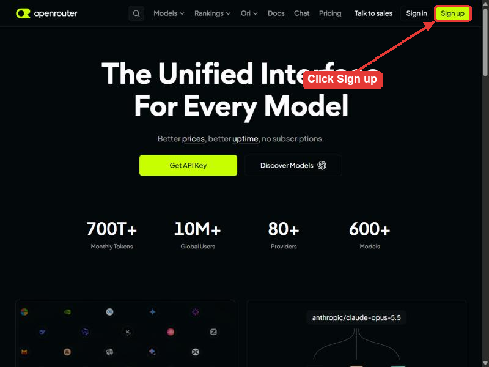
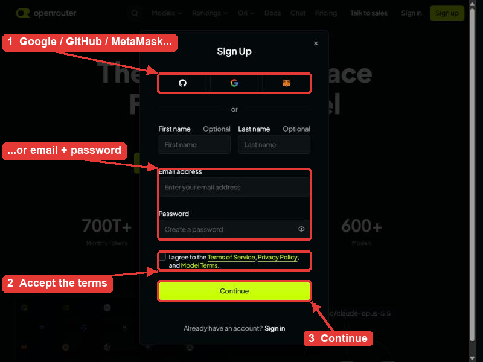
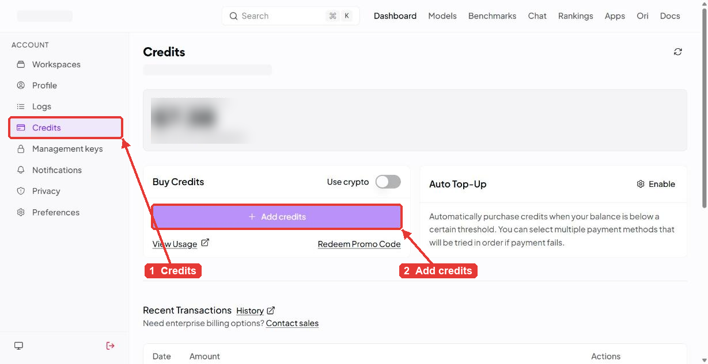
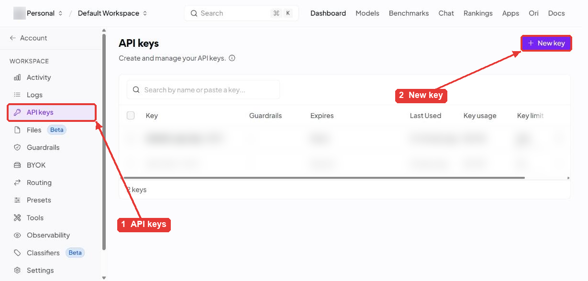
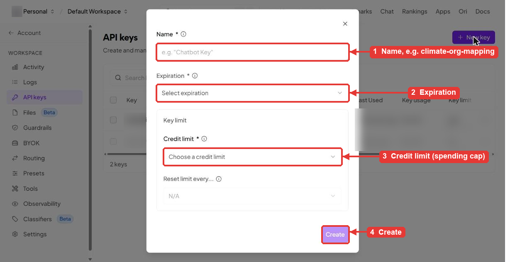
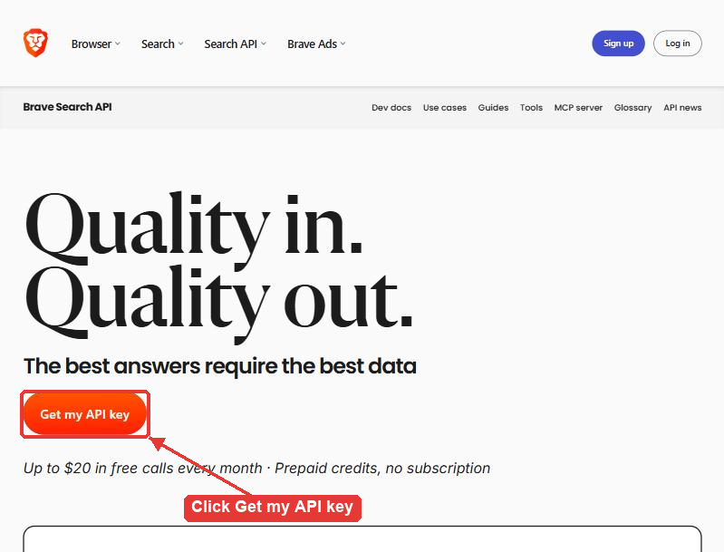
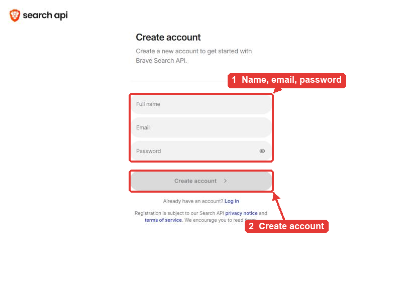
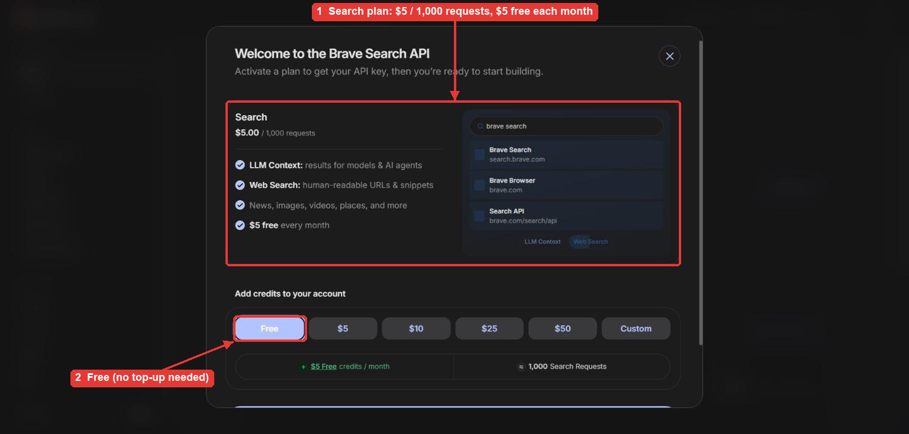
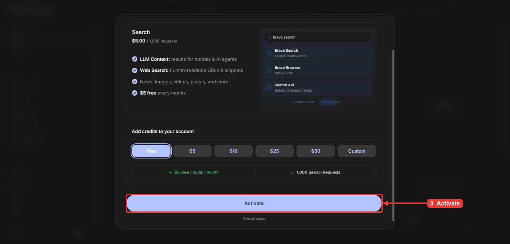
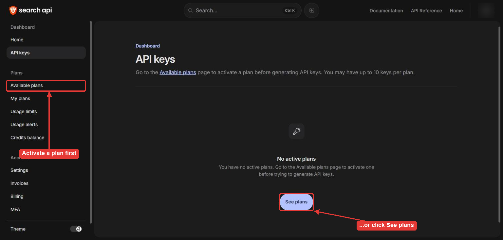

# API Keys Creation: OpenRouter and Brave Search

The pipeline needs two keys:

| Key | Used for | Required? |
|---|---|---|
| `OPENROUTER_API_KEY` | Web-search fallback (`openai/gpt-5.4-mini`) and Jev classification (`typesafe/jev-1.13`) | Yes |
| `BRAVE_API_KEY` | Cheaper primary website discovery | Yes |

---

## Part 1: OpenRouter

### Step 1: Create an account

Go to [openrouter.ai](https://openrouter.ai/) and click **Sign up** (top right).

Sign up with Google, GitHub or MetaMask, or with an email address and password. Tick the terms box and click **Continue**. If you used email, confirm it from the message OpenRouter sends.

### Step 2: Add credits

The models this project uses are paid, so the account needs a prepaid balance. Open **Credits** from the account menu (or go to [openrouter.ai/settings/credits](https://openrouter.ai/settings/credits)) and click **Add credits**. $5–$10 is plenty for a pilot run.

### Step 3: Create the API key

Open **API keys** in the left sidebar (or go to [openrouter.ai/keys](https://openrouter.ai/keys)) and click **New key**.

Fill in the dialog:

1. **Name:** something recognizable, e.g. `climate-org-mapping`.
2. **Expiration:** pick an expiry date, or "Never" for a long-running project.
3. **Credit limit:** a spending cap for this key. Setting one (e.g. $10) means a runaway script can't spend more than that.
4. Click **Create**.

**Copy the key right away.** It starts with `sk-or-v1-` and OpenRouter shows it only once. If you lose it, delete the key and create a new one.

---

## Part 2: Brave Search API

### Step 1: Create an account

Go to [brave.com/search/api](https://brave.com/search/api/) and click **Get my API key**.

Enter your name, email and password, then click **Create account**. Confirm your email from the message Brave sends, then log in.

### Step 2: Activate the Search plan

Brave only lets you create a key after a plan is active. Right after your first login, a **Welcome** dialog shows the **Search** plan: $5 per 1,000 requests, with $5 of free credit every month (about 1,000 searches). 

Scroll down and click **Activate**. Brave may ask for billing details to confirm the account even on the free credit.

If you closed the dialog, the **API keys** page shows "No active plans". Use **Available plans** in the sidebar, or **See plans**, to get back to it.

### Step 3: Create the API key

Once the plan is active, open **API keys** in the sidebar and use the button to add a key. Give it a name like `climate-org-mapping`. Copy the key it shows; the project sends it to Brave in the `X-Subscription-Token` header. You can have up to 10 keys per plan.

To avoid surprise charges, set a cap under **Usage limits** in the sidebar.

---

