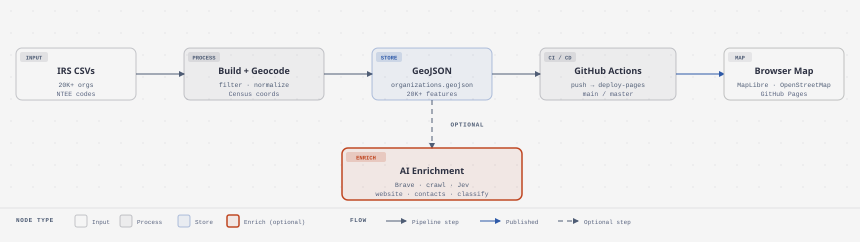
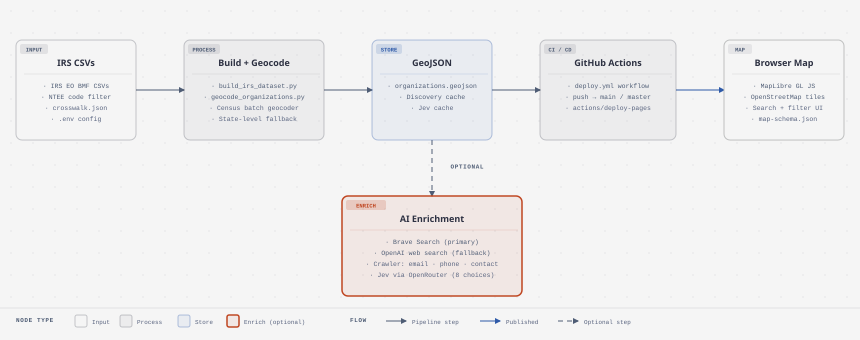

# GCC Climate Organization Map

This repository contains the first working slice of GCC's nationwide climate-organization map. The current prototype filters the supplied IRS EO BMF files, converts selected organizations into a normalized GeoJSON dataset, and displays them over OpenStreetMap in a searchable, filterable MapLibre map.

The IRS data is a placeholder base layer. The build stage does not invent coordinates. A separate geocoding stage assigns Census address-range coordinates when available and clearly labeled ZIP- or city-centroid fallbacks otherwise. Records matching neither have no map point.

## Data-to-map flow



### More detailed view

```mermaid
flowchart LR
    subgraph Inputs["1. Input data and configuration"]
        IRS["IRS EO BMF state CSV files"]
        Codes["Selected NTEE codes"]
        External["Future external CSV / JSON / GeoJSON"]
        Schema["map-schema.json<br/>controlled filter values"]
        Env[".env API keys and model settings"]
    end

    subgraph Normalize["2. Normalize records"]
        Build["build_irs_dataset.py<br/>filter, clean, stable IDs,<br/>provisional schema categories"]
        Adapter["normalize_external_data_without_llm.py<br/>aliases, canonical values,<br/>deterministic fallback rules"]
        Merge["Combined normalized organizations<br/>(future merge step: TBD)"]
    end

    subgraph Locate["3. Assign map coordinates"]
        Geocode["geocode_organizations.py"]
        GeoCache[(Census geocode cache)]
        Census["U.S. Census batch geocoder"]
        Fallback["ZIP / city centroid fallback"]
    end

    subgraph Enrich["4. Optional AI enrichment: --enrich-with-jev"]
        BraveSearch["Brave Search<br/>primary website discovery"]
        Discovery["OpenRouter web search<br/>fallback for low-confidence cases"]
        DiscoveryCache[(Supabase pipeline_cache<br/>Brave, discovery, web search)]
        Crawl["Deterministic crawler<br/>email, phone, contact page"]
        ContactFallback["OpenRouter web search<br/>contact fallback when site blocked"]
        Jev["System One Jev via OpenRouter<br/>all 8 schema choices in one request"]
        JevCache[(Supabase pipeline_cache<br/>Jev answers)]
    end

    subgraph Publish["5. Validate and save"]
        GeoJSON[(Supabase organizations table)]
        Validate["main.py validation<br/>FeatureCollection, Points,<br/>coordinate ranges"]
        Server["Local static HTTP server"]
    end

    subgraph Browser["6. Browser map"]
        App["app.js loads approved organizations + schema"]
        Filters["Search, counts, and schema filters"]
        MapLibre["MapLibre clusters, points, and tooltips"]
        OSM["OpenStreetMap raster tiles"]
        User["Climate Org Mapping UI"]
    end

    IRS --> Build
    Codes --> Build
    External --> Adapter
    Build --> Merge
    Adapter -.->|"enabled when additional sources are integrated"| Merge
    Merge --> Geocode

    GeoCache --> Geocode
    Geocode -.->|"--use-census"| Census
    Census --> GeoCache
    Geocode -->|"usable address match"| GeoJSON
    Geocode -->|"missing or failed match"| Fallback
    Fallback --> GeoJSON

    GeoJSON -.->|"records not already enriched"| BraveSearch
    Env -.-> BraveSearch
    BraveSearch -->|"confident match"| DiscoveryCache
    BraveSearch -.->|"no confident match"| Discovery
    Env -.-> Discovery
    DiscoveryCache --> Discovery
    Discovery --> DiscoveryCache
    DiscoveryCache -->|"official site found"| Crawl
    Crawl -->|"accessible: contacts extracted"| GeoJSON
    Crawl -.->|"blocked or unreachable"| ContactFallback
    ContactFallback -->|"email, phone, contact page"| GeoJSON
    DiscoveryCache -->|"official site found"| Jev
    Env -.-> Jev
    JevCache --> Jev
    Jev --> JevCache
    Jev -->|"website, summary, canonical categories"| GeoJSON

    GeoJSON --> Validate
    Validate --> Server
    Server -->|"static app files"| App
    GeoJSON -->|"approved rows, map fields only"| App
    Schema --> App
    App --> Filters
    App --> MapLibre
    Filters -->|"filtered FeatureCollection"| MapLibre
    OSM --> MapLibre
    MapLibre --> User
```



<details>
<summary>Full pipeline diagram (Mermaid source)</summary>



</details>

Solid arrows show the normal data path. Dashed arrows show optional, incremental, or externally configured work. OpenStreetMap supplies the background tiles; organization coordinates, tooltip content, and filter values come from the Supabase `organizations` table, the only data store. See [`Docs/Planning/flow.md`](Docs/Planning/flow.md) for the detailed stage-by-stage description.

## Repository contents

- `Data/`: supplied IRS state CSV files.
- `Docs/Planning/`: living project plans, architecture, specifications, and decisions.
- `Docs/Research and Requirements/`: supplied source requirements and research.
- `scripts/build_irs_dataset.py`: IRS filter and normalization.
- `scripts/supabase_store.py`: the pipeline's reads and writes to Supabase (organizations, API caches, API log).
- `app/`: static map application.
- `tests/`: ingestion unit tests.
- `Docs/Planning/idea.md`: consolidated product and architecture concept.

## Prerequisites

- Python 3.10 or newer.
- An internet connection while viewing the prototype, because MapLibre and OpenStreetMap tiles are loaded from public CDNs.

No Python or Node packages are required.

Copy `.env.example` to `.env` if `.env` is not already present, then add local API credentials there. `main.py` and the standalone enrichment script load it automatically. `.env` is ignored by version control.

## Quick start

From the repository root, run the complete safe local workflow:

```powershell
python main.py
```

This builds the IRS dataset, applies cached Census coordinates and ZIP/city fallbacks without making external geocoding requests, validates the GeoJSON, and serves the map at `http://127.0.0.1:8000`.

To rebuild without starting the web server:

```powershell
python main.py --no-serve
```

To submit uncached IRS street addresses through the official U.S. Census batch geocoder before applying fallbacks:

```powershell
python main.py --use-census
```

### Website enrichment and Jev classification

Run a small paid pilot before scaling to the complete dataset.

Populate `OPENROUTER_API_KEY` in `.env`. Optionally add `BRAVE_API_KEY` to enable the cheaper Brave Search primary path. [Docs/Setup/api-keys-setup.md](Docs/Setup/api-keys-setup.md) walks through creating both keys, with screenshots. Then run:

```powershell
python main.py --enrich-with-jev --enrichment-limit 10
```

For each selected organization, the enrichment pipeline:

1. **Website discovery** — queries Brave Search (when `BRAVE_API_KEY` is set) and accepts the top result when it scores ≥ 0.5 on name, city, state, and `.org` domain signals. Falls back to OpenRouter web search for low-confidence cases.
2. **Contact extraction** — deterministically crawls the accepted website (respecting `robots.txt`) to extract a public organizational email, phone number, and contact-page URL. If the crawler is blocked by `robots.txt` or the site is unreachable, an OpenRouter web-search call is used as a fallback to surface contact details from its cached index.
3. **Jev classification** — sends the full evidence package to `typesafe/jev-1.13` through OpenRouter's Decisions API. Jev answers all eight controlled schema questions in one request. It is the sole model classifier in this enrichment path.

Discovery, crawl results, and Jev responses are cached in the Supabase `pipeline_cache` table. Rebuilt runs reuse successful enrichment and do not repeat paid calls. Review a representative labeled pilot before increasing the limit because model confidence is not the same as domain accuracy.

The pipeline is incremental by default. It loads the organizations from Supabase and reuses them instead of rescanning IRS files, then saves only new and changed records back. It needs `SUPABASE_URL` and `SUPABASE_SERVICE_ROLE_KEY` in `.env`. Completed coordinates are also reused. Enrichment excludes records already completed with the current discovery version, search model, Jev question version, and Jev model before applying `--enrichment-limit`. Use `python main.py --rebuild` only when the IRS source data or normalization logic has changed.

This command transmits each organization's public IRS street, city, state, and ZIP fields to `geocoding.geo.census.gov`. Results and non-matches are cached in Supabase (`pipeline_cache`, kind `census`), so unchanged addresses are not resubmitted. The public OpenStreetMap Nominatim server is intentionally not used for this nationwide bulk operation.

Internally, both geocoding modes are implemented by `geocode_organizations.py`. The IRS dataset builder always emits `geometry: null` and `location_precision: ungeocoded`; it contains no temporary coordinate generation.

Use `python main.py --help` for input, output, record-limit, server, and geocoding options. The component scripts remain executable independently for debugging.

Normalize a future CSV or JSON source into the GCC schema:

```powershell
python scripts/normalize_external_data_without_llm.py `
  --input Data/NewSource/organizations.csv `
  --output Data/NewSource/organizations.normalized.json `
  --source "New Source"
```

The normalizer recognizes common column names automatically. For an unusual source, provide a JSON field map whose keys are GCC schema fields and whose values are source column names:

```json
{
  "name": "Legal Organization Name",
  "website_url": "Homepage",
  "address": "Mailing Street",
  "climate_categories": "Primary Focus"
}
```

Pass it with `--field-map path/to/field-map.json`.

To serve the map without running the pipeline:

```powershell
python -m http.server 8000 --directory app
```

Open `http://localhost:8000` in a browser.

Do not open `app/index.html` directly from the filesystem. Browsers normally block the schema fetch from a `file://` page.

## Build options

Force a rebuild from the IRS files (existing website and Jev enrichment is kept). The rebuild first downloads the 51 state files from irs.gov into `Data/IRS EO BMF/`, fetching only files the IRS has updated since the local copy; if irs.gov is unreachable it uses the local copies:

```powershell
python main.py --rebuild --no-serve
```

Show every supported argument:

```powershell
python main.py --help
```

Results are saved to the Supabase `organizations` table.

## Verification

Run the ingestion tests:

```powershell
python -m unittest discover -s tests -v
```

Check JavaScript syntax when Node.js is available:

```powershell
node --check app/app.js
```

## Environment and secrets

`BRAVE_API_KEY` is optional but recommended: it enables the cheaper Brave Search primary discovery path. `OPENROUTER_API_KEY` is required: it covers both the fallback web-search path (used when Brave returns no confident match, or when no Brave key is set) and Jev classification. `SEARCH_MODEL` (default `openai/gpt-5.4-nano`) and `SEARCH_BASE_URL` configure the Brave-result picker and the web-search fallback. The paid contact lookup is off unless `--contact-fallback` is passed. `JEV_MODEL` defaults to `typesafe/jev-1.13`, and `JEV_BASE_URL` defaults to OpenRouter's Decisions API. Never commit any key or paste it into a source file.

## Known limitations

- IRS records do not contain latitude and longitude. The geocoding stage supplies map coordinates and records their precision.
- Census matches use address-range coordinates. Unmatched records fall back to their ZIP centroid, then their city centroid (both from the Census Gazetteer), scattered up to ~550 m so pins don't stack. Records matching neither are left off the map.
- Base IRS profiles do not contain websites or summaries. Optional enrichment can add an official website and source-grounded summary; provisional or model-generated GCC classifications are still not organization-verified.
- The map loads every approved organization from Supabase on each visit (~1 MB compressed); a much larger nationwide dataset may require vector tiles or server-side spatial queries. Supabase Free includes ~5 GB egress a month (~5,000 map loads).
- Public OpenStreetMap tiles and CDN assets are appropriate for prototype development, not an assumed production service agreement.

## Troubleshooting

### Dataset unavailable

Check that `app/supabase-config.js` has the project URL and anon key (`python -m scripts.sync_supabase` writes it) and that the Supabase project is not paused. Serve the `app` directory through HTTP rather than opening the HTML file directly.

### The basemap is blank

Confirm the browser has internet access and is permitted to reach `unpkg.com` and `tile.openstreetmap.org`.

### The build cannot find CSV files

Run the command from the repository root or provide `--input-dir` with the correct directory. The build searches recursively for files named `eo_*.csv`, so source-specific subfolders such as `Data/IRS EO BMF/` are supported.

### Geocoding is interrupted

Run `python scripts/geocode_organizations.py` again. Completed matches and non-matches are read from the cache, and only new or changed addresses are submitted.

## Further documentation

Start with [`Docs/Planning/idea.md`](Docs/Planning/idea.md), [`Docs/Planning/product-requirements-document.md`](Docs/Planning/product-requirements-document.md), [`Docs/Planning/technical-design-document.md`](Docs/Planning/technical-design-document.md), and [`Docs/Planning/irs-schema-classification.md`](Docs/Planning/irs-schema-classification.md).


To move the project to another GitHub account and Supabase project (code, website, database, admin page and survey), follow [`Docs/Setup/transfer-guide.md`](Docs/Setup/transfer-guide.md).
